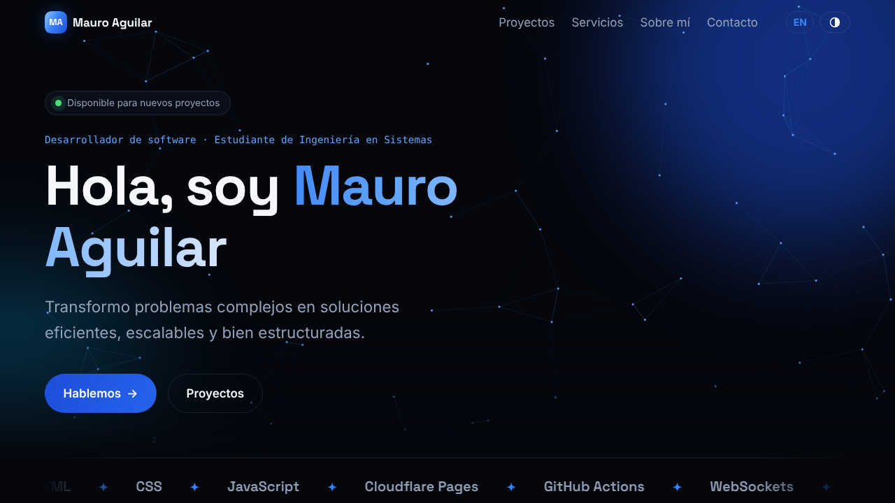

# Portfolio · Mauro Aguilar

Sitio personal bilingüe (español e inglés) donde muestro mis proyectos y los servicios que ofrezco como desarrollador web.

**En vivo:** [ptfmauroaglr.pages.dev](https://ptfmauroaglr.pages.dev)



## Qué tiene

- **Astro estático, sin frameworks de UI:** HTML, CSS y JavaScript escritos a mano. Cada página llega al navegador casi sin JavaScript.
- **Bilingüe de verdad:** rutas en español (`/`) e inglés (`/en/`) que comparten las mismas vistas; todos los textos fijos viven en un solo archivo de traducciones.
- **Proyectos como contenido:** cada proyecto es un archivo Markdown por idioma, validado con un esquema; si falta un dato, el build falla.
- **Accesible y mobile first:** HTML semántico, foco visible, contraste revisado, modo claro y oscuro.
- **Despliegue continuo:** Cloudflare Pages publica cada push a `main` y genera una vista previa por pull request.

## Stack

Astro · TypeScript · CSS propio con design tokens · Cloudflare Pages · Web3Forms

---

## Desarrollo local

### Requisitos

- Node.js 22.12 o más nuevo (recomendado: la versión LTS de https://nodejs.org)
- VS Code con la extensión **Astro** (VS Code te la sugiere al abrir la carpeta)

### Empezar

```bash
npm install        # instala Astro (una sola vez)
npm run dev        # abre http://localhost:4321 y recarga al guardar
npm run build      # genera el sitio final en dist/
npm run preview    # sirve dist/ para probarlo antes de publicar
```

### Dónde está cada cosa

| Carpeta | Qué hay |
| --- | --- |
| `src/pages/` | Una ruta por archivo. Español en la raíz (`/proyectos`), inglés en `en/` (`/en/projects`). Solo eligen la vista y el idioma. |
| `src/views/` | El contenido de cada página, compartido entre idiomas. |
| `src/components/` | Piezas reutilizables: header, footer, tarjeta de proyecto, formulario, SEO. |
| `src/layouts/` | El esqueleto HTML común (`<html>`, `<head>`, header y footer). |
| `src/i18n/ui.ts` | Todos los textos fijos en los dos idiomas, y las rutas de cada página. |
| `src/content/projects/` | Un `.md` por proyecto y por idioma (`es/` y `en/`). |
| `src/styles/` | `tokens.css` (colores, espacios) y `global.css`. |
| `src/scripts/` | JavaScript del navegador: modo oscuro, menú móvil y formulario. |
| `public/` | Archivos que se copian tal cual: favicon, robots.txt, CV. |

### Sumar un proyecto

1. Creá `src/content/projects/es/mi-proyecto.md` y `src/content/projects/en/mi-proyecto.md` (mismo nombre de archivo).
2. Copiá el encabezado (frontmatter) de otro proyecto y cambiá los datos. `status` puede ser `idea`, `en-desarrollo` o `publicado`.
3. Escribí el caso de estudio debajo, en Markdown. Si falta un campo obligatorio, `npm run build` te avisa.

### Formulario de contacto

1. Pedí una clave gratis en https://web3forms.com con el correo donde querés recibir los mensajes.
2. Copiá `.env.example` como `.env` y pegá la clave en `PUBLIC_WEB3FORMS_KEY`.
3. En Cloudflare Pages, cargá la misma variable en *Settings → Environment variables*.

### Publicar (Cloudflare Pages)

1. En Cloudflare: *Workers & Pages → Create → Pages → Connect to Git* y elegí este repo.
2. Framework preset: **Astro**. Build command: `npm run build`. Output: `dist`.
3. Cada push a `main` publica el sitio; cada pull request genera una vista previa.

## Hoja de ruta

- [x] Etapa 0: esqueleto bilingüe, contenido de ejemplo y CI.
- [x] Etapa 0: publicar en Cloudflare Pages.
- [ ] Etapa 1: diseño propio y caso de estudio del portfolio (hechos), formulario funcionando y ajustes finales.
- [ ] Etapa 2: dominio, SEO, analítica y página de Servicios con precios.

## Licencia

[MIT](LICENSE) © 2026 Mauro Aguilar
